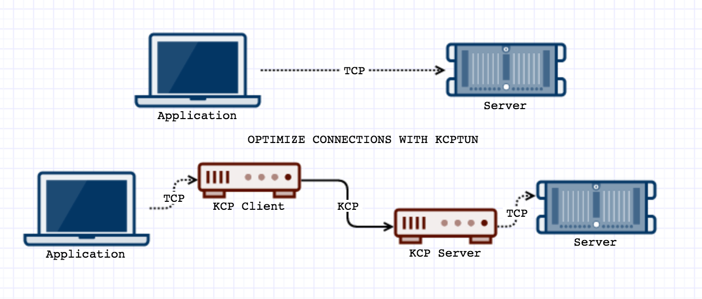
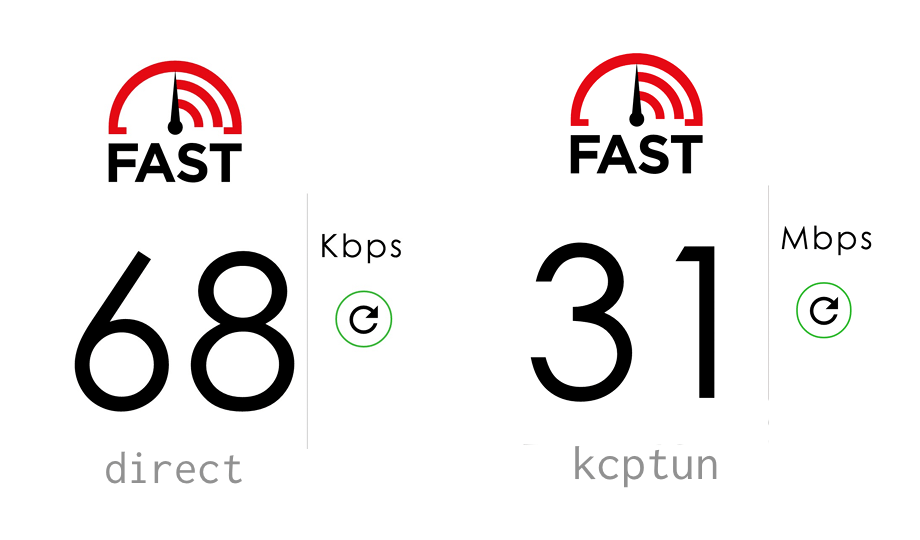
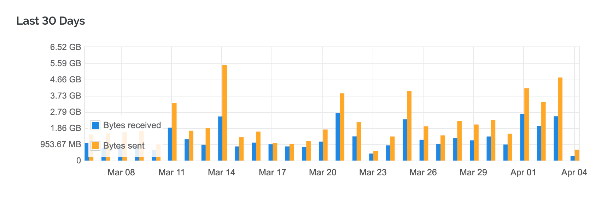
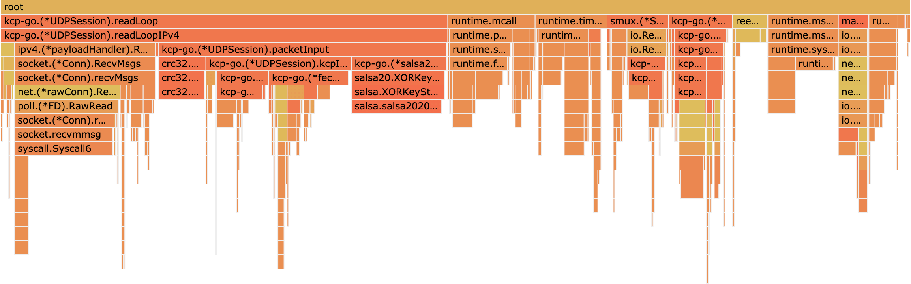
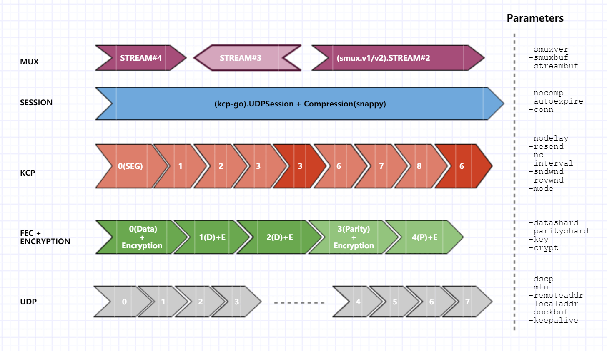
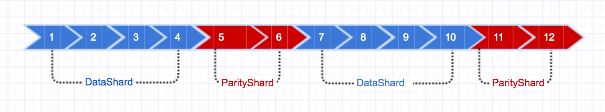

#  

> **Source code only:** This repository provides source code; prebuilt binaries and release packages are not provided.
>
> The source is provided for research and reference purposes only.



## Disclaimer
> **⚠️ [中文免责声明 / Chinese Disclaimer](disclaimer_zh.md)**

1. Technical Purpose: This software is a general-purpose network transport accelerator based on the KCP protocol. It is designed solely for academic research, network performance testing, and legal optimization of data transmission in high-latency environments.

2. Official Channel: The developer maintains only one official website: github.com/xtaci/kcptun. Any other websites, mirrors, or repackaged versions are NOT endorsed by the developer.

3. User Responsibility: Users are strictly required to comply with all local laws and regulations. You must NOT use this tool to establish illegal network channels, circumvent national regulatory systems, or engage in any activities that violate the laws of the People's Republic of China or your own jurisdiction.

4. No Liability: The developer provides this software "as is" without any express or implied warranties. Under no circumstances shall the developer be liable for any legal consequences arising from improper use of this tool or the use of unofficial versions.

5. Acceptance: By using this software, you agree to these terms. If you do not agree, delete all related code and binaries immediately.

## Table of Contents

- [Requirements](#requirements)
- [QuickStart](#quickstart)
- [Building from source](#building-from-source)
- [Performance](#performance)
- [Basic Tuning Guide](#basic-tuning-guide)
   - [To Improve Throughput](#to-improve-throughput)
   - [To Improve Latency](#to-improve-latency)
   - [Head-of-Line Blocking (HOLB)](#head-of-line-blocking-holb)
   - [Slow Devices](#slow-devices)
- [Expert Tuning Guide](#expert-tuning-guide)
   - [Overview](#overview)
   - [Multiport Dialer](#multiport-dialer)
   - [Per-session Application Write Rate Limit](#per-session-application-write-rate-limit)
   - [Forward Error Correction](#forward-error-correction)
   - [DSCP](#dscp)
   - [Packet Encryption and Security](#packet-encryption-and-security)
   - [Quantum Resistance](#quantum-resistance)
   - [Memory Control](#memory-control)
   - [Compression](#compression)
   - [SNMP](#snmp)
- [FAQ](#faq)
- [References](#references)


## Requirements

| Target | Supported | Recommended |
| --- | --- | --- |
| System | darwin freebsd linux windows | freebsd linux |
| Memory | >32 MB | > 64 MB |
| CPU | ANY | amd64 with AES-NI & AVX2 |

Building from source requires Go 1.26.0 or later.

*NOTE: If you are using KVM, ensure that the guest OS supports AES instructions.*

## QuickStart

Increase the number of open files on your server, as:

`ulimit -n 65535`, or write it in `~/.bashrc`.

Suggested [sysctl.conf](https://github.com/xtaci/kcptun/blob/master/dist/linux/sysctl_linux) parameters for Linux to improve UDP packet handling:

```
net.core.rmem_max=26214400 # BDP - Bandwidth Delay Product
net.core.rmem_default=26214400
net.core.wmem_max=26214400
net.core.wmem_default=26214400
net.core.netdev_max_backlog=2048 # Tune with -rcvwnd
```
FreeBSD-related sysctl settings can be found here: https://github.com/xtaci/kcptun/blob/master/dist/freebsd/sysctl_freebsd

You can also increase the per-socket buffer (default 4 MiB) with:
```
-sockbuf 16777216
```
Larger buffers can absorb more bursts but use additional memory; tune them to your workload.

Build the client and server for the local platform with `go build -o client ./client` and `go build -o server ./server` (run the respective binary on each host).

```
KCP Client: ./client -r "KCP_SERVER_IP:4000" -l ":9000" -mode fast3 -nocomp -autoexpire 900 -sockbuf 16777216 -dscp 46
KCP Server: ./server -t "TARGET_IP:9000" -l ":4000" -mode fast3 -nocomp -sockbuf 16777216 -dscp 46
```
The above commands will establish a port forwarding channel for port 9000/tcp as follows:

> Application -> **KCP Client(9000/tcp) -> KCP Server(4000/udp)** -> Target Server(9000/tcp) 

which relays the original connection:

> Application -> Target Server(9000/tcp) 

**_OR START WITH THESE COMPLETE CONFIGURATION FILES:_** [client](https://github.com/xtaci/kcptun/blob/master/dist/local.json.example) --> [server](https://github.com/xtaci/kcptun/blob/master/dist/server.json.example)

## Building from source

```
$ git clone https://github.com/xtaci/kcptun.git
$ cd kcptun
$ go build -o client ./client
$ go build -o server ./server
```

These commands build binaries for the current platform. To cross-compile and package release builds for the supported targets, run:

```
$ ./build-release.sh
$ cd build
```

`build-release.sh` creates release tarballs without macOS hidden metadata files (such as `._*`) to improve cross-platform extraction compatibility.

## Performance

  





> Practical bandwidth graph with parameters:  -mode fast3 -ds 10 -ps 3

kcptun uses kcp-go's shared timer scheduler, packet batching, batched UDP I/O where supported, and ring-buffer queues. These implementation details reduce per-session scheduling and I/O overhead; actual performance depends on the operating system, hardware, and workload.


## Basic Tuning Guide

### To Improve Throughput

> **Q: I have a high-speed network link. How can I maximize bandwidth?**

> **A:** Increase `-rcvwnd` on the KCP Client and `-sndwnd` on the KCP Server **simultaneously and gradually**. The minimum of these values determines the maximum transfer rate of the link using the formula `wnd * mtu / rtt`. Then test your connection by downloading content to verify it meets your requirements. (The MTU can be adjusted using the `-mtu` parameter.)

### To Improve Latency

> **Q: I'm using kcptun for gaming and want to minimize latency.**

> **A:** Latency spikes often indicate packet loss. You can reduce lag by adjusting the `-mode` parameter.

> For example: `-mode fast3`

> Retransmission aggressiveness/responsiveness for embedded modes:

> *fast3 > fast2 > fast > normal > default*

### Head-of-Line Blocking (HOLB)


When all streams are multiplexed over a single physical channel, Head-of-Line Blocking (HOLB) can occur. You can mitigate this by tuning the following parameters:

- `-smuxbuf`: Sets the total buffer size for the multiplexer (default: 4MB). Increasing this value (e.g., `-smuxbuf 8388608` for 8MB) can reduce the chance of HOLB, but will increase memory usage.

smux v2 provides per-stream buffer limits:

- `-smuxver 2`: Enables smux v2 (must be set identically on both client and server).
- `-streambuf`: Limits the maximum buffer size per stream, in bytes (e.g., `-streambuf 2097152` for 2MB per stream).

**Recommended usage:**
1. If you experience HOLB, first try increasing `-smuxbuf` to 8MB or higher.
2. For finer memory control, enable smux v2 and use `-streambuf` to limit per-stream memory usage.
3. The `-smuxver` parameter **must** be identical on both client and server, otherwise the connection will fail.
4. Limiting `-streambuf` on the receiver side applies back-pressure to the sender, preventing buffer overflow along the link.

Example:
```
./client -r "server_ip:4000" -l ":9000" -smuxver 2 -smuxbuf 8388608 -streambuf 2097152
```
This command sets the total smux buffer to 8MB and limits each stream to 2MB.

### Slow Devices

kcptun uses **Reed-Solomon Codes** for packet recovery, which requires substantial computational resources. Low-end ARM devices may experience performance issues with kcptun. For optimal performance, a multi-core x86 server CPU such as AMD Opteron is recommended. If you must use ARM routers, it's advisable to disable `FEC` and use `salsa20` for encryption.

**How to optimize for slow devices:**

- **Disable FEC:** Set both `--datashard 0 --parityshard 0` on client and server to turn off Forward Error Correction.
- **Enable salsa20 encryption:** Use `--crypt salsa20` on both client and server for a lightweight cipher.

Example:
```
./client ... --datashard 0 --parityshard 0 --crypt salsa20
./server ... --datashard 0 --parityshard 0 --crypt salsa20
```
These settings can significantly reduce CPU usage and improve performance on ARM routers and other low-end hardware.

## Expert Tuning Guide

### Overview

<p align="left"></p>

The command-line options and defaults change over time, so use the help output from the version you built:

```bash
./client -h
./server -h
```

### Multiport Dialer

kcptun allows connectivity across a defined port range to improve transmission efficiency and network robustness.

**How it works:**
- Address format: `IP:min-max` (e.g., `1.2.3.4:3000-4000`).
- On each new connection, the client randomly picks one port in the given range and connects to it.
- The server must listen on the same port range so it can accept connections on any port within that range.

Under the hood, addresses are parsed and validated as `[host, minPort, maxPort]` (see [std/multiport.go](std/multiport.go)), and the client selects a random port in `[minPort, maxPort]` for each session (see [client/dial.go](client/dial.go)).

**Usage:**
1. **Server** — listen on a range:
   ```bash
   ./server -l ":3000-4000" ...
   ```
   Note: open the UDP ports 3000–4000 in your firewall.

2. **Client** — dial to a range:
   ```bash
   ./client -r "SERVER_IP:3000-4000" ...
   ```

Each new kcptun UDP/KCP session uses one randomly selected port from the range; sessions do not hop ports mid-connection.

**Notes:**
- Valid ranges are `1–65535` with `min <= max`.
- Single-port usage still works: `IP:29900` (no hyphen).
- Works with `--tcp` mode as well; the remote port is still chosen from the range before initializing the connection.

### Per-session Application Write Rate Limit

`--ratelimit <bytes-per-second>` limits the rate at which each KCP session accepts application data written by kcptun. For example, `--ratelimit 1048576` sets a limit of 1 MiB/s per session; `0` disables the limit.

This is not a wire-speed packet shaper. It counts application bytes, not KCP, FEC, encryption, retransmission, or UDP/IP overhead, and does not limit out-of-band packets. Because the limit is applied independently to each session and can allow bursts, the aggregate rate across multiple sessions can exceed the configured value. Use it for per-session bandwidth control; it does not guarantee smooth packet timing or prevent kernel/network drops.

### Forward Error Correction

kcptun uses [Reed-Solomon Codes](https://en.wikipedia.org/wiki/Reed%E2%80%93Solomon_error_correction) to recover lost packets, which significantly improves data throughput on lossy networks.

You can configure the FEC parameters using the following flags:
- `--datashard, -ds`: Number of data shards (default: 10).
- `--parityshard, -ps`: Number of parity shards (default: 3).

**How it works:**

For every `datashard` data packets sent, `parityshard` redundant packets are generated. The receiver can reconstruct missing data when enough shards from that group arrive; the number of recoverable missing data shards is bounded by the parity count.

**Overhead:**

The approximate parity overhead is `parityshard / datashard`, excluding packet and protocol overhead. The default setting (10 data, 3 parity) adds about 30% parity data.

**Configuration Guide:**

1. **Automatic receive-side detection**: The decoder detects incoming data/parity shard patterns and can adapt when the peer uses different shard settings. The endpoints' FEC settings therefore do not need to match. Changing a sender's settings still requires restarting that sender.
2. **Tuning**:
   - Increase `-parityshard` to improve reliability on highly lossy networks, at the cost of higher bandwidth usage.
   - Decrease `-parityshard` to reduce bandwidth overhead if the network quality is good.
3. **Disable FEC**: Set both `--datashard 0 --parityshard 0` on both endpoints to disable Forward Error Correction. This saves CPU and bandwidth but removes FEC recovery; KCP retransmission remains active.

**Long-Distance Communication:**

In long-distance communication (e.g., cross-continent), the Round-Trip Time (RTT) is high. If a packet is lost, waiting for retransmission (RTO) incurs a significant latency penalty. FEC allows the receiver to reconstruct lost packets immediately without waiting for retransmission, making it highly effective for reducing latency in high-RTT environments.



### DSCP

Differentiated Services (DiffServ) is a computer networking architecture that specifies a simple, scalable, and coarse-grained mechanism for classifying and managing network traffic and providing Quality of Service (QoS) on modern IP networks. DiffServ can, for example, be used to provide low-latency service to critical network traffic such as voice or streaming media while providing simple best-effort service to non-critical traffic such as web browsing or file transfers.

DiffServ uses a 6-bit differentiated services code point (DSCP) in the 8-bit differentiated services field (DS field) in the IP header for packet classification purposes. The DS field and ECN field replace the outdated IPv4 TOS field.

Set each side with ```-dscp value```. Here are some [commonly used DSCP values](https://en.wikipedia.org/wiki/Differentiated_services#Commonly_used_DSCP_values).

### Packet Encryption and Security

kcptun can encrypt packets using several cipher modes, including the AEAD mode `aes-128-gcm`. Packet encryption covers the FEC and KCP contents, but does not hide endpoints, packet sizes, timing, or traffic volume.

Legacy non-AEAD cipher modes use an unkeyed CRC-32 checksum to detect accidental corruption; `crypt=null` omits this packet protection. CRC-32 does not provide cryptographic integrity or protection against deliberate packet modification. Use an AEAD mode such as `aes-128-gcm` when packet integrity and authentication are required. AEAD authenticates packets with the configured key; it does not by itself authenticate a user's identity or provide application-level replay protection. Use an authenticated application protocol where those guarantees are needed.

The `-crypt` method and `-key` must match on both endpoints. Do not use `-crypt xor` for security. Cipher performance depends on hardware and workload, so benchmark on the target system instead of relying on old benchmark figures.

### Quantum Resistance
Quantum Resistance, also known as quantum-secure, post-quantum, or quantum-safe cryptography, refers to cryptographic algorithms that can withstand potential code-breaking attempts by quantum computers.
kcptun optionally supports [QPP](https://github.com/xtaci/qpp), based on [Kuang's Quantum Permutation Pad](https://epjquantumtechnology.springeropen.com/articles/10.1140/epjqt/s40507-022-00145-y).

To enable QPP in kcptun, set the following parameters:
```
   --QPP                Enable Quantum Permutation Pads (QPP)
   --QPPCount value     The prime number of pads to use for QPP. More pads provide greater encryption security. Each pad requires 256 bytes. (default: 61)
```
You can also specify
```json
     "qpp":true,
     "qpp-count":61,
```
in your client and server-side JSON configuration files. These two parameters must be identical on both sides.

1. To achieve **effective quantum resistance**, specify at least **211** bytes in the `-key` parameter and ensure `-QPPCount` is at least **7**.
2. Ensure that `-QPPCount` is **COPRIME (互素)** to **8** (or simply set it to a **PRIME** number) such as: 
```101, 103, 107, 109, 113, 127, 131, 137, 139, 149, 151, 157, 163, 167, 173, 179, 181, 191, 193, 197, 199... ```

### Memory Control

Memory use depends on the number of active sessions, KCP send/receive windows, FEC shard settings, and smux buffers. kcp-go reuses packet buffers through `sync.Pool`, but the Go runtime may discard pooled buffers during garbage collection; the pool is not a fixed memory reservation or a memory limit.

Tune `-sndwnd`, `-rcvwnd`, `-datashard`, `-parityshard`, `-conn`, and `-smuxbuf` with available memory and expected concurrency in mind. Larger windows and more FEC parity can increase memory and CPU use. Lowering `GOGC` may reduce the heap target at the cost of more frequent garbage collection; measure the effect under the actual workload.

### Compression

kcptun has builtin snappy algorithms for compressing streams:

> Snappy is a compression/decompression library. It does not aim for maximum
> compression, or compatibility with any other compression library; instead,
> it aims for very high speeds and reasonable compression. For instance,
> compared to the fastest mode of zlib, Snappy is an order of magnitude faster
> for most inputs, but the resulting compressed files are anywhere from 20% to
> 100% bigger.

> Reference: http://google.github.io/snappy/

Compression can save bandwidth for **PLAINTEXT** data and is particularly useful for specific scenarios such as cross-datacenter replication. Compressing redologs in database management systems or Kafka-like message queues before transferring data streams across continents can significantly improve speed.

Compression is enabled by default. You can disable it by setting ```-nocomp``` on **BOTH** the KCP Client and KCP Server (the setting **MUST** be **IDENTICAL** on both sides).

### SNMP

```go
type Snmp struct {
    BytesSent           uint64
    BytesReceived       uint64
    MaxConn             uint64
    ActiveOpens         uint64
    PassiveOpens        uint64
    CurrEstab           uint64
    InErrs              uint64
    InCsumErrors        uint64
    KCPInErrors         uint64
    InPkts              uint64
    OutPkts             uint64
    InSegs              uint64
    OutSegs             uint64
    InBytes             uint64
    OutBytes            uint64
    RetransSegs         uint64
    FastRetransSegs     uint64
    EarlyRetransSegs    uint64
    LostSegs            uint64
    RepeatSegs          uint64
    FECFullShardSet     uint64
    FECRecovered        uint64
    FECErrs             uint64
    FECParityShards     uint64
    FECShardSet         uint64
    FECShardMin         uint64
    RingBufferSndQueue  uint64
    RingBufferRcvQueue  uint64
    RingBufferSndBuffer uint64
    OOBPackets          uint64
}
```

On Linux, macOS, and FreeBSD, sending `SIGUSR1` to the client or server logs the current kcp-go SNMP counters. These include application and UDP traffic, retransmissions, FEC recovery, queue sizes, and out-of-band packets; use them to diagnose a live workload.


## FAQ

### Q: Which parameters must be identical on both client and server?
A: The following parameters **MUST** be exactly the same on both client and server, otherwise the connection will fail:

- `--key` and `--crypt`
- `--QPP` and `--QPPCount`
- `--nocomp`
- `--smuxver`

FEC data/parity shard settings do not have to match: the receiver detects the incoming shard pattern.

### Q: How can I manually fine-tune KCP protocol parameters?
A: You can use `-mode manual` along with `-nodelay`, `-interval`, `-resend`, and `-nc` for advanced tuning. For example:

```
-mode manual -nodelay 1 -interval 20 -resend 2 -nc 1
```

Manual mode allows you to customize low-level KCP behavior. **Make sure you fully understand each parameter before changing them**, as improper settings may degrade performance or stability. See the [KCP protocol configuration documentation](https://github.com/skywind3000/kcp/blob/master/README.en.md#protocol-configuration) for details.

### Q: Are there example configuration files?
A: Yes, official example configuration files are provided for quick setup:

- [Client example](https://github.com/xtaci/kcptun/blob/master/dist/local.json.example)
- [Server example](https://github.com/xtaci/kcptun/blob/master/dist/server.json.example)

### Q: What is the difference between `crypt=none` and `crypt=null`?
A: Neither option encrypts or authenticates packet contents:

- `crypt=none`: Uses a no-op cipher while retaining the legacy packet framing and CRC-32 corruption check. The checksum is not cryptographic authentication.
- `crypt=null`: Omits the kcp-go packet encryption/checksum layer. KCP and FEC framing remain; this does not send raw application data.

Use an authenticated mode such as `aes-128-gcm` when packet integrity is required.

### References

1. https://github.com/skywind3000/kcp -- KCP - A Fast and Reliable ARQ Protocol.
1. https://github.com/xtaci/kcp-go/ -- A Production-Grade Reliable-UDP Library for golang
1. https://github.com/klauspost/reedsolomon -- Reed-Solomon Erasure Coding in Go.
1. https://en.wikipedia.org/wiki/Differentiated_services -- DSCP.
1. http://google.github.io/snappy/ -- A fast compressor/decompressor.
1. https://www.backblaze.com/blog/reed-solomon/ -- Reed-Solomon Explained.
1. https://en.wikipedia.org/wiki/PBKDF2 -- Key stretching.
1. http://blog.appcanary.com/2016/encrypt-or-compress.html -- Should you encrypt or compress first?
1. https://github.com/hashicorp/yamux -- Connection multiplexing library.
1. https://tools.ietf.org/html/rfc6937 -- Proportional Rate Reduction for TCP.
1. https://tools.ietf.org/html/rfc5827 -- Early Retransmit for TCP and Stream Control Transmission Protocol (SCTP).
1. http://http2.github.io/ -- What is HTTP/2?
1. http://www.lartc.org/ -- Linux Advanced Routing & Traffic Control
1. https://en.wikipedia.org/wiki/Noisy-channel_coding_theorem -- Noisy channel coding theorem
1. https://zhuanlan.zhihu.com/p/53849089 -- kcptun开发小记


***（注意：kcptun没有任何社交网站的账号，请小心骗子。）***
